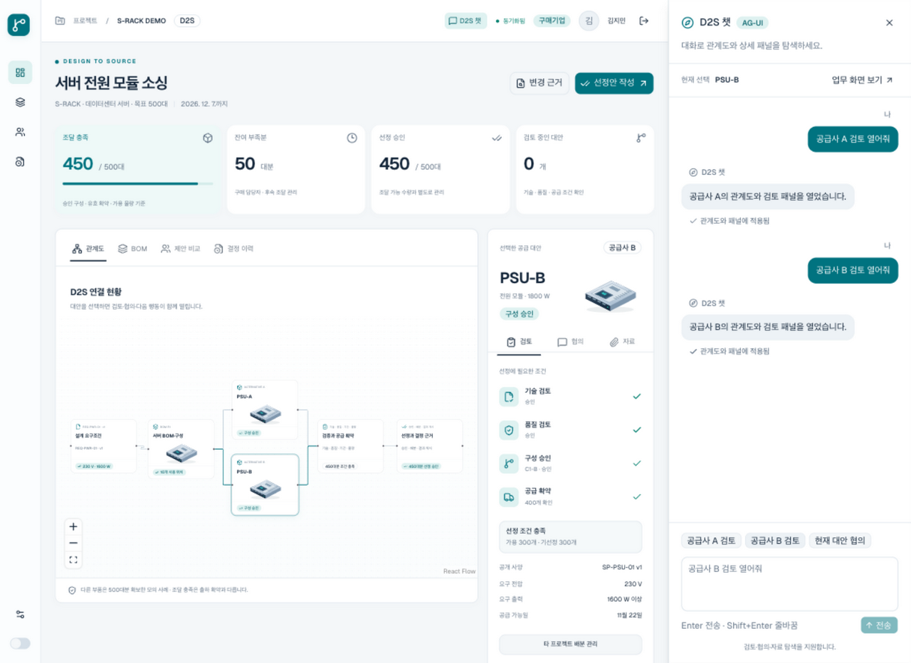

# AG-UI 명령 탐색

기준일: 2026-10-08. 사용자가 선택한 첫 경험은 “명령하면 관계도와 상세 패널을 함께 보여주기”다. 현재 합성 D2S 화면에 적용한다. 후속 요청에 따라 입력창을 오른쪽 채팅 드로워로 전환했다.

## Goal과 산출물

사용자는 한 번의 명령으로 권한이 있는 공급 대안을 선택하고, 그 대안의 관계도와 검토·협의·자료 패널을 함께 연다. 기존 D2S 객체와 업무 상태를 사용한다.

산출물은 오른쪽 채팅 드로워, 대화 기록, 실행·취소·오류 안내, AG-UI 서버 연결, 관계도·패널의 선택 동기화, 권한 검증 사례다. 자유로운 문장 이해와 업무 판단은 후속 범위다. 현재 명령 해석은 정해진 규칙으로 처리한다. 모델 서비스나 API 키는 필요하지 않다.

## 화면과 대화

상단 `D2S 챗` 버튼으로 드로워를 연다. 데스크톱에서는 관계도·상세 패널과 나란히 표시하며 배경 업무 화면도 조작할 수 있다. 좁은 화면에서는 겹쳐 열리고 `업무 화면 보기`로 현재 결과에 돌아간다. Escape와 닫기 버튼을 지원한다.

Enter는 전송, Shift+Enter는 줄바꿈이다. 한글 조합 중 Enter는 전송하지 않는다. 명령과 완료·오류·취소 응답을 말풍선으로 남긴다. 화면의 현재 선택이 바뀌면 드로워의 선택 표시도 바뀐다. 그래프 폭이 달라지면 전체 관계가 보이도록 배율을 조정한다.

닫기·다시 열기는 현재 페이지의 대화와 작성 중 입력을 유지한다. 처리 중 닫기는 해당 요청을 취소한다. 늦은 응답은 화면에 적용하지 않는다. 대화는 브라우저 메모리에만 있으며 새로고침·로그아웃·계정 변경 시 초기화한다. 서버에는 각 명령과 현재 선택만 보내므로 이전 대화를 해석하는 기능은 없다.

## 지원 명령

| 입력 예                 | 화면 결과                                    |
| ----------------------- | -------------------------------------------- |
| `공급사 B 검토 열어줘`  | 관계도로 전환하고 PSU-B와 검토 패널을 선택   |
| `공급사 A 협의 열어줘`  | PSU-A와 해당 공급사의 개별 협의 패널을 선택  |
| `PSU-B 자료 보기`       | PSU-B와 자료 패널을 선택                     |
| `현재 대안 협의 열어줘` | 현재 선택한 대안을 유지하고 협의 패널을 선택 |

`검토`, `협의`, `자료` 뒤의 `열기`, `보기`, `보여줘`도 지원한다. 화면의 예시 버튼은 현재 사용자가 볼 수 있는 공급사만 표시한다. 지원하지 않는 명령은 입력 예를 안내한다.

## 연결 방식

공식 `@ag-ui/client`, `@ag-ui/core`, `@ag-ui/encoder` 1.0.2를 사용한다. 기존 React·React Flow·shadcn/ui 화면을 유지한다. 클라이언트는 첫 명령에서 불러온다.

`HttpAgent → POST /api/navigation → 권한에 맞는 Workspace 조회 → 명령 해석 → AG-UI SSE → 화면 선택 적용` 순서로 처리한다. AG-UI의 HTTP 연결은 `RunAgentInput`과 표준 이벤트를 교환한다. [공식 연결 구조](https://docs.ag-ui.com/concepts/architecture)

정상 응답은 `RUN_STARTED → STEP_STARTED → STEP_FINISHED → STATE_SNAPSHOT → TEXT_MESSAGE_START/CONTENT/END → RUN_FINISHED`다. 실패는 `RUN_ERROR`로 끝난다. 요청 형식·인증·CSRF 검사는 스트림 시작 전에 HTTP 오류로 반환한다.

`STATE_SNAPSHOT`의 공유 상태는 `actorId`, `sourceVersion`, `supplier`, `tab`, `panel`만 포함한다. 스냅샷을 받은 뒤 실행 완료까지 확인하고 관계도·패널을 함께 바꾼다. 취소하거나 다른 실행으로 대체된 응답은 화면에 적용하지 않는다. 스냅샷과 증분 변경은 AG-UI가 정의한 상태 전달 수단이다. [공식 상태 관리](https://docs.ag-ui.com/concepts/state)

업무 데이터는 기존 API와 `/api/events`에서 읽는다. AG-UI의 상태를 BOM·승인·선정·수량 데이터에 적용하지 않는다. `sourceVersion`은 탐색에 사용한 공개 화면의 버전이며 업무 버전을 덮어쓰는 값이 아니다.

## 권한과 완료 기준

| ID     | 평가 기준                                 | 검증 방법                                                         |
| ------ | ----------------------------------------- | ----------------------------------------------------------------- |
| NAV-01 | 명령 대상, 선택한 노드, 패널 대상이 일치  | 실제 SDK의 이벤트 수신과 브라우저에서 BOM → 관계도·검토 전환 확인 |
| NAV-02 | 탐색 전후 업무 상태·선정·감사 기록이 동일 | API 실행 전후 Workspace와 결정 기록 비교                          |
| NAV-03 | 공급사는 자사 대안만 탐색                 | 공급사 B 세션에서 B 허용, A·없는 대상은 동일한 오류, 스냅샷 없음  |
| NAV-04 | 패널과 요청에도 기존 권한 적용            | 설계 역할의 상업 협의·자료 차단, 인증·CSRF·참여 권한 철회 검사    |
| NAV-05 | 지원하지 않는 명령은 현재 선택을 유지     | 승인 명령 거절 후 노드와 패널 비교                                |
| NAV-06 | 지연·취소·모션 감소 상황에서 선택이 정확  | 취소 후 늦은 응답, 키보드 제출, 모션 감소를 브라우저에서 확인     |

드로워 평가 기준은 열기·닫기와 초점 복귀, 대화 유지, Enter·한글 입력, 명령의 화면 반영, 닫은 뒤 지연 응답 무시, 계정 간 대화 분리, 1440 px·1024 px 배치다.

서버는 클라이언트의 조직·역할·공개 범위를 신뢰하지 않는다. 세션과 현재 참여 권한으로 공개된 대상만 찾는다. 클라이언트가 전달한 업무 상태는 사용하지 않으며, 임의 도구·문맥·추가 탐색 속성을 거절한다. 가격·비공개 BOM·다른 공급사 데이터는 탐색 응답에 포함하지 않는다.

실제 시험 결과와 미검증 범위는 [실행 검증 기록](d2s-implementation-validation.ko.md)을 따른다. 이후 자유로운 자연어 명령을 추가하려면 모델의 역할, 허용 도구, 비용, 품질 평가를 별도로 정한다. 승인·선정의 업무 판단은 현재 명령 탐색의 범위에 포함하지 않는다.
