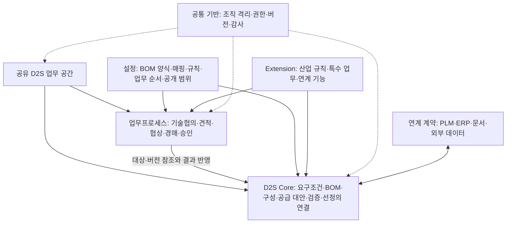
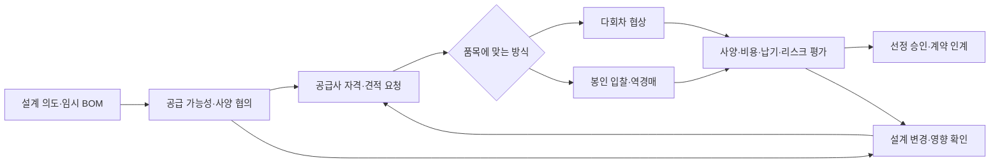

# D2S 중심 SRM SaaS 기획안 v0.1

> 범위 정정 (2026-10-08): AI Native는 개발팀의 작업 방식이다. 제품 내 AI 요약·매핑·협상 초안 및 모델 API 연계는 사용자 요청에 포함되지 않으며 현재 구현 범위와 합격 기준에서 제외한다. 변경 근거는 저장된 상태·규칙·이력으로 제공한다.

작성일: 2026-10-08

상태: 첫 제품군은 데이터센터용 서버로 확정했다. 상세 구현 범위, 일정, 기술 스택, 성능 수치는 논의용 제안이다.

첫 적용 분야: 전자·전기제품 중 데이터센터용 서버. 최초 목표 기업: Dell. 장기 방향: 다른 제조업으로 확장.

후속 작업: [실행 계획](srm-d2s-execution-plan.ko.md)과 [서버 D2S 기능 명세 초안](server-d2s-functional-spec-v0.1.ko.md)을 작성했다. 기획·설계의 검토 자료이며 실제 고객 검증과 제품 구현은 후속 단계다.

구현 검토: [상태 관리·모션·기술 스택 검토](d2s-state-motion-stack-review-v0.1.ko.md)에 조건부 구현 판단, 스택 우선안과 검증 계획을 정리했다. 구현 성능과 실제 고객 적합성은 아직 미검증이다.

## 1. 합의한 전제와 확인할 사실

- 구매기업은 제품을 설계하고 공급사를 선정한다. 이 문서에서는 사용자 표현인 ‘개발사’를 ‘구매기업’으로 통일한다.
- D2S(Design to Source)는 설계·BOM 단계부터 공급사 선정까지의 연결을 뜻한다.
- 첫 제품군은 데이터센터용 서버로 확정했다. 주요 사용자는 Dell의 서버 설계·구매·품질 담당자와 부품·모듈 공급사다.
- 대표 플랫폼, CPU 중심 또는 GPU 포함 구성, 냉각 방식, 첫 부품군은 검증 시나리오를 통해 정한다. 범용 2U 랙 서버와 전원·냉각 부품군은 초기 논의용 제안이다.
- 솔루션의 Core는 D2S다. 설계 의도·요구조건·BOM·구성·공급 대안·검증·소싱 결정을 연결한다. 보편적인 SRM 업무프로세스는 공통 제품 기능으로 유지하고 D2S Core 위에서 실행한다. 산업별·고객별 차이는 설정과 Extension으로 수용한다.
- 구매기업과 공급사는 같은 업무 공간에서 협업한다. 각 참여자는 허용된 데이터만 받는다.
- 초기 협업은 구매기업과 공급사 한 곳씩 개별 협의한다. 한 프로젝트에 여러 공급사가 참여할 수 있으며, 각 공급사와의 요청·자료·대화를 분리한다. 복수 공급사가 서로 참여하는 공동 기술 협의는 후속 범위다.
- 초기에는 필수 조건을 충족한 일부 물량의 선정을 허용한다. 잔여 부족분·후속 담당자를 기록하고 전체 목표의 미완료 상태를 유지한다. 조달 충족 수량과 선정 승인 수량은 구분한다.
- 첫 화면 시안의 시각적 방향은 유지한다. 화면의 중심에는 설계부터 소싱 결정까지의 연결을 두고, 공급 차질 대응은 그 안의 한 사용 사례로 표현한다.
- AI Native는 개발팀의 기획·설계·구현·검증 작업 방식에 적용한다. 제품 AI 기능은 별도 요구가 생길 때 논의한다.
- 실제 업무 담당자·자료는 현재 미확보다. 모의 사례로 기획과 프로토타입 설계를 시작하기로 합의했다.
- 화면은 정적 이미지로 먼저 검토한다. 실행형 프로토타입을 포함한 개발은 사용자의 명시적인 승인 후 착수한다.
- Dell의 실제 BOM, 구매 절차, 내부 시스템, 데이터 접근 조건은 아직 확인하지 않았다. 아래의 Dell 적용 시나리오는 검증할 가설이다.

Dell의 FY2026 Form 10-K는 단일·소수 공급원 의존과 대체 공급사 자격 검증의 지연 위험을 설명한다. 부품 전환과 서버 공급·수요의 불균형도 언급한다. 따라서 ‘설계 변경 후 공급 가능한 대안을 빠르게 검증한다’를 초기 가치 가설로 제안한다. 이는 Dell의 현재 SRM에 해당 기능이 없다는 뜻은 아니다. [Dell FY2026 Form 10-K](https://www.sec.gov/Archives/edgar/data/1571996/000157199626000008/dell-20260130.htm)

## 2. 제1원칙과 문서 작성 규칙

### 제1원칙으로 분해한 문제

| 근본적으로 필요한 것 | 제품 설계에 주는 결론 |
|---|---|
| 설계 선택과 공급 선택은 서로의 조건을 바꾼다. | 요구조건부터 소싱 결정까지의 관계를 D2S Core에 유지한다. 기술 협의·견적·협상은 같은 대상과 버전을 참조한다. |
| 무엇을 구매할지 같은 의미로 이해해야 한다. | 고객의 표 형식과 부품·BOM의 업무 의미를 분리한다. |
| 요구를 충족하는 부품을 제때 공급할 수 있어야 한다. | 가격 비교 전에 사양, 자격, 생산능력, 납기를 검증한다. |
| 설계 변경은 이전 견적의 전제를 바꾼다. | BOM, 요구사항, 견적, 승인에 각각 버전을 둔다. 변경 영향을 연결한다. |
| 협업에는 공유가 필요하고 경쟁에는 비밀 유지가 필요하다. | 같은 업무 맥락을 공유하되, 참여자별 데이터 접근을 통제한다. |
| 다른 기업에서 재사용하려면 특정 기업의 데이터와 독립되어야 한다. | 재사용 기능, 고객 설정, 업무 데이터를 분리한다. |
| 결정을 빨리 내리려면 현재 상태와 다음 행동을 알아야 한다. | 프로젝트 공간에서 흐름, 병목, 근거, 조치를 연결한다. |
| 검토 자료와 조직의 결정은 책임 주체가 다르다. | 시스템은 근거와 상태를 표시한다. 권한자가 업무 결정을 승인한다. |

ASD-STE100은 영어 기술문서 표준이다. 이 한국어 기획서는 정식 STE 준수를 주장하지 않는다. 용어 일관성, 짧은 문장, 명시적 주체, 조건 우선, 문장당 하나의 요구사항을 작성 원칙으로 적용한다. 영문 산출물의 정식 준수 여부는 별도 검토가 필요하다. [ASD-STE100 공식 설명](https://www.asd-ste100.org/about_STE.html)

요구사항은 `ID / 주체 / 조건 / 행동 / 관찰 가능한 결과 / 검증 방법`으로 작성한다.

예: `SEC-01 / 시스템 / 공급사 A가 견적을 조회하면 / A에게 허용한 데이터만 반환한다 / 공급사 B의 견적 값이 응답에 없다 / API·파일·검색 응답 검사`.

‘직관적이다’, ‘빠르다’, ‘유연하다’는 단독 합격 기준으로 사용하지 않는다. 관찰할 행동, 시간, 오류, 표본을 함께 정의한다.

## 3. Goal과 성공 지표

### 최상위 Goal

**설계 의도와 요구조건을 조달 가능한 제품 구성으로 구체화하고, 공급사의 제안과 검증 결과를 설계에 반영하며, 각 설계 선택과 공급사 선정의 근거를 연결한다. 구매기업과 공급사는 필요한 정보만 공유하며 D2S 결정을 더 짧은 시간에 완료한다. 고객별 차이는 설정과 재사용 가능한 Extension으로 수용한다.**

첫 적용 대상의 Goal은 **서버의 설계 요구조건과 BOM·구성을 정의하고, 공급 가능성·호환성·전력·냉각 조건을 검증해 목표 일정에 맞는 공급 대안과 선정 결정을 완성하는 것**이다. 검증 단위는 특정 요구조건·BOM 개정·적용 조건을 가진 서버 구성이다. 설계 변경과 전원 모듈 공급 차질은 이 연결이 유지되는지 확인하는 대표 사례다.

구성의 사용 가능 여부는 `충족 / 위반 / 미검증`으로 구분한다. 규칙 검사 통과와 설계·품질 담당자의 최종 승인을 별도로 기록한다. 자료가 없는 대안을 충족 상태로 표시하지 않는다.

최상위 성과 지표는 ‘D2S 검토 범위의 최초 요구조건 등록부터 공급사 선정 승인까지의 경과 시간’이다. 검토 범위는 대상 제품, 책임자, 초기 요구조건, 수량·기간 가정을 식별할 수 있는 상태로 정의한다. 중간 지점으로 ‘소싱 가능 설계 패키지 승인’을 기록해 설계 구체화 시간과 소싱 시간을 나누어 측정한다. 이 패키지는 협의에 필요한 임시 BOM, 요구조건, 수량·기간 가정, 공개 범위를 포함한다. 최종 설계 확정 전에 공급사 협의를 시작할 수 있다.

아래 수치는 초기 제안치다. Dell의 현재 성능, 업계 평균, 달성 실적을 의미하지 않는다. 실제 파일과 업무 기준선을 확보한 뒤 확정한다.

| ID | Goal | 제안한 평가 기준 | 측정 방법 |
|---|---|---|---|
| G0 | D2S를 업무프로세스의 공통 기반으로 유지한다. | 정의한 평가 사례에서 요구조건→구성·BOM→공급 대안→검증→선정 근거의 추적 100%. 프로세스 방식 변경으로 인한 참조 단절 0건. | 신규 설계, 설계 변경, 공급 대안 변경 사례를 비교한다. 프로세스 시작·변경·종료 후에도 동일한 D2S 대상과 버전을 재현한다. |
| G1 | D2S 결정 시간을 줄인다. | 비교 가능한 파일럿에서 중앙값 30% 단축. 긴 지연 사례도 별도 검토. | 시작·종료 이벤트의 경과 시간을 측정한다. 유사 복잡도·공급사 수의 기존 사례와 비교한다. |
| G2 | BOM 차이를 설정으로 수용한다. | 합의한 대표 템플릿 3종을 코드 수정·애플리케이션 재배포 없이 처리한다. 필수 의미·계층·수량·단위를 보존한다. | 교육받은 업무 관리자가 매핑, 검증, 화면, 공개 범위를 설정한다. 원본과 변환 결과를 대조한다. |
| G3 | 변경으로 인한 잘못된 결정을 막는다. | 평가 표본에서 변경 영향이 있는 견적·승인 누락 0건. | 기준 BOM 변경 후 재견적·재검토 대상의 정답 목록과 비교한다. |
| G4 | 같은 업무 공간에서 안전하게 협업한다. | 정의한 교차 조직·교차 공급사 공격 시나리오에서 정보 노출 0건. 주요 결정의 버전·승인자·근거 추적 100%. | UI, API, 검색, 파일, 알림, 실시간 이벤트, 내보내기를 검사한다. |
| G5 | 화면 이동과 이해 비용을 줄인다. | 핵심 과업의 90% 이상을 프로젝트 공간 이탈 없이 완료한다. 참여자의 80% 이상이 30초 안에 현재 단계·주요 병목·다음 담당자를 찾는다. | 구매·설계·공급사 역할별 관찰 테스트를 한다. 초기에는 역할별 5명 이상을 제안한다. |
| G6 | Extension을 다른 기업에서 재사용한다. | 한 Extension을 독립된 두 번째 기업의 요구·데이터로 검증한다. Core 분기 0건. 첫 기업 데이터 포함 0건. | 설치, 고객별 설정, 호환성, 업데이트, 제거·데이터 처리 절차를 검증한다. |
| G7 | AI Native 개발팀의 생산성을 검증한다. | 수용 기준을 통과한 변경의 처리 시간·결함 유출·재작업을 기록한다. 개선 목표는 개발 기준선 확보 후 합의한다. | 같은 난도의 개발 과업을 비교하고 사람의 검토 시간을 포함한다. |
| G8 | 도입과 운영을 반복할 수 있다. | 두 번째 기업 도입에 고객별 Core 배포가 필요하지 않다. 도입 인시·지원 인시·운영 비용을 계측한다. | 같은 범위의 설정 작업을 비교한다. 수익성 기준은 가격·운영 모델을 정한 뒤 합의한다. |

G1은 공급사 대기 시간을 포함한다. 내부 처리 시간과 외부 대기 시간도 따로 기록한다. 취소·보류·미완료 건을 누락하지 않는다. 완료율과 진행 중 건의 경과 시간을 함께 보고한다. 표본이 작으면 개선 신호로 해석하며 통계적 입증을 주장하지 않는다.

시간 단축은 필수 품질·자격·권한 검증을 통과한 건에서 평가한다. 비용 효과는 동일 사양·수량·납기·통화 조건으로 비교한다. 품질 문제나 사후 재작업을 줄였는지도 추적한다.

## 4. D2S Core와 업무프로세스의 경계

| 계층 | 책임 | 예시 |
|---|---|---|
| D2S Core | 설계부터 소싱까지의 대상·관계·근거를 보존한다. | 설계 의도·요구조건, 품목·BOM 사용 위치, 구성 스냅샷, 공급 대안, 검증 근거, 선정 결과 |
| 업무프로세스 | D2S 대상을 참조해 참여자의 과업과 상태 전이를 실행한다. | 기술 협의, 공급사 자격 검토, RFI·RFQ, 협상·입찰·경매, 승인, 계약 인계, 성과 피드백 |
| 공통 기반 | 모든 기능에 같은 보호·기록 원칙을 적용한다. | 조직·참여자, 거래별 공개 권한, 버전 식별, 감사 기록 |
| 설정 | 이미 지원하는 의미와 기능의 고객별 조합 | 필드, 명칭, 단위, 필수 조건, 화면 배치, 파일 열 매핑, 승인 단계, 공개 범위 |
| 산업 Extension | 여러 고객이 공유할 수 있는 산업 규칙 | 전자부품의 제조사 부품번호, 승인 대체품, 변경·단종 통지, 자격 검증 요구 |
| 서버 Extension | 데이터센터용 서버에 적용할 구성·검증 기능 | 구성 옵션, 부품 호환 조건, 전력·냉각 제약, 펌웨어 검증 조건, 구성별 공급 영향 |
| 업무·연계 Extension | 별도 계산 또는 외부 시스템과의 연결 | 공급 배분 계산, 특수 평가 방식, 특정 PLM/ERP 연결 |
| 고객 설정 | 특정 기업의 명칭·조직·정책 값 | Dell 검증을 통해 확정할 용어·필수 필드·승인 기준. 현재는 미정 |

표준 SRM의 공급사 등록·자격, 소싱, 평가·협상, 선정·계약 연계, 성과·개선은 공통 업무 기능으로 제공한다. D2S 안에서 실행하는 업무는 대상 요구조건·구성·공급 대안과 기준 버전을 참조한다. 공급사 프로필·자격처럼 여러 프로젝트가 사용하는 정보는 적용 범위와 유효성을 확인해 연결한다.

D2S Core는 프로세스가 시작되기 전의 설계 후보와 종료 후의 선정 근거를 유지한다. 동일한 구성에 기술 검토와 상업 협의를 병렬로 연결할 수 있다. 각 프로세스는 자신의 상태·담당자·결과를 보존하고, 권한과 변경 규칙에 따라 결과를 D2S 대상에 반영한다. 전체 진행률 하나로 기술 적합성·공급 확약·선정 승인을 대체하지 않는다.

프로세스를 교체하거나 추가해도 D2S 대상 식별자와 기준 버전은 유지한다. 협상에서 입찰로 전환하면 이전 협상 기록을 보존하고 새 이벤트와 규칙을 만든다. 공급사의 대안 제안은 변경 검토를 거쳐 새 설계·구성 버전으로 반영한다. 기존 승인 구성과 과거 견적을 덮어쓰지 않는다.

설계·BOM의 원본 시스템과 수정 책임은 객체별로 정한다. PLM 등에서 가져온 경우에는 원본 식별자와 버전을 유지한다. 이 논리적 계층 구분은 별도 서비스나 데이터베이스 도입을 확정하지 않는다.

초기 구현 후보는 모듈 경계가 분명한 단일 애플리케이션과 관계형 데이터 저장소다. 별도 서비스·그래프 저장소·공개 마켓플레이스의 도입은 필요와 운영 근거를 확인한 뒤 결정한다. 특정 기술 스택은 이번 문서에서 확정하지 않는다.

## 5. 코드 변경 없는 BOM 커스터마이징

### 공통 의미를 보존한다

Core는 고객의 BOM 양식을 하나로 강제하지 않는다. 다음 의미를 안정적으로 식별한다.

- 기업별 품목 식별자와 개정 번호.
- BOM 안에서 부품이 쓰인 위치와 부모·자식 관계.
- 수량과 단위.
- 제품 구성 옵션과 적용 시점·범위.
- 요구사항, 승인 대체품 관계, 공급사 제안과의 연결.
- 원본 문서·시스템, 원본 버전, 변환 이력.

같은 부품도 서로 다른 BOM 위치에서 수량·적용 조건이 다를 수 있다. 품목 자체와 BOM 사용 위치를 분리한다. 서로 다른 기업의 품목번호가 같다는 이유로 같은 부품으로 취급하지 않는다.

설계 BOM과 제조 BOM은 관계와 변경 이력으로 연결한다. 두 BOM을 강제로 같은 구조로 덮어쓰지 않는다. 임의 계층의 의미가 다른 경우에는 명시적 매핑과 검증이 필요하다.

### 설정 패키지를 구성한다

| 설정 항목 | 관리자가 정할 내용 | 검증 예 |
|---|---|---|
| 데이터 정의 | 자료형, 단위, 허용 값, 필수·조건부 필수 필드 | 전원 부품에는 정격 출력이 필요하다. |
| 관계 정의 | 지원하는 BOM 계층, 대체품 그룹, 옵션 조건 | 옵션이 다른 두 부품을 동시에 필수로 계산하지 않는다. |
| 입력 매핑 | 고객 파일의 열·계층을 공통 의미에 연결 | `Qty`와 `수량`을 같은 수량 의미에 연결한다. |
| 화면 정의 | 열 순서, 묶음, 편집·조회 형태 | 설계자는 사양을 먼저 보고 구매자는 조달 조건을 먼저 본다. |
| 계산·검증 | 제한된 수식, 단위 변환, 범위·일관성 검사 | 단위 변환 근거와 변환 실패를 표시한다. |
| 업무·공개 정책 | 승인 단계, 변경 시 재검토 조건, 데이터 공개 대상 | 내부 목표원가는 공급사에게 제공하지 않는다. |

예시 템플릿은 서버 시스템 BOM, 시스템 보드 조립 BOM, 전원 모듈 BOM의 세 종류다. 이는 Dell의 실제 양식이 아니다. 실제 검증에서는 Dell 또는 설계 파트너의 익명화 자료로 대체한다.

서버 시스템 BOM은 CPU·메모리·드라이브·네트워크·전원·냉각의 구성 옵션을 연결한다. 시스템 보드 조립 BOM은 하위 부품과 사용 위치를 표현한다. 전원 모듈 BOM은 내부 부품과 요구 사양을 표현한다. 모듈 공급사의 내부 BOM 전체 공개를 전제하지 않으며, 공개가 허용된 범위에서 요구 조건과 검증 증거를 연결한다.

서버 Extension의 호환 조건은 플랫폼·부품·구성·개정에 적용 범위를 둔다. 같은 용량·출력이라는 이유로 부품을 서로 대체하지 않는다. 규칙마다 근거, 유효 기간 또는 적용 개정, 확인 책임자를 기록한다.

관리자 흐름은 `원본 연결 → 의미 매핑 → 검증 결과 확인 → 화면·권한 확인 → 설정 버전 발행`이다. 관리자가 승인한 매핑만 사용한다.

설정에는 버전을 둔다. 발행된 소싱 이벤트는 사용한 BOM·설정 버전을 고정한다. 새 필수 항목을 추가해도 과거 견적의 의미를 조용히 바꾸지 않는다. 진행 중 업무를 새 버전으로 옮기려면 영향 분석과 승인을 거친다.

### No-code의 보장 범위를 명시한다

플랫폼이 지원하는 필드, 관계, 계산, 업무 전이 안에서는 코드 수정 없이 구성한다. 임의 스크립트·SQL·고객별 애플리케이션 배포는 이 기준의 ‘설정’으로 인정하지 않는다.

새로운 최적화 알고리즘, 새로운 업무 객체, 특수 프로토콜은 Extension 개발이 필요할 수 있다. ‘모든 미래 요구를 코드 없이 수용한다’는 목표는 세우지 않는다. 새 기능을 Extension으로 제공하면, 이후 고객은 해당 기능을 설정으로 사용할 수 있다.

## 6. Extension의 재사용과 운영

Extension 패키지는 기능 식별자, 버전, 지원 Core 버전, 의존성, 요청 권한, 데이터 정의, 업무 규칙, 검증 사례, 데이터 전환 절차를 포함한다.

공통 기능 → 산업 기능 → 기업 설정의 적용 순서를 명시한다. 충돌이 있으면 설치 전에 보여준다. 기업 설정이나 Extension은 Core의 조직 격리와 필수 감사 정책을 약화할 수 없다.

초기에는 검토된 패키지를 배포하는 관리형 카탈로그를 제안한다. 패키지는 공개 전 권한, 데이터 이식성, 성능, 호환성 검증을 통과한다. 실행 코드가 필요한 패키지는 승인된 API와 제한된 권한을 사용하며, 임의로 Core 저장소를 수정하지 않는다.

재사용 대상은 스키마·규칙·업무·화면·연계 기능이다. 실제 BOM, 가격, 공급사 명단, 문서, 자격 증거는 자동으로 함께 배포하지 않는다. 고객이 소유한 규칙과 지식도 공유 권한·라이선스를 확인해야 한다.

업데이트는 진행 중 업무에 강제 적용하지 않는다. 지원 버전, 전환 계획, 실패 시 복구 방법을 검증한다. 데이터 구조 변경이 있으면 이전 코드로 되돌리는 것만으로 복구가 끝난다고 가정하지 않는다. 제거 시 데이터 보존·반출·삭제 방법도 정한다.

재사용 검증은 복제한 데모 계정으로 끝내지 않는다. 독립된 두 번째 기업의 요구를 사용한다. 해당 기업이 확보되기 전에는 재사용 가능성이 검증되지 않은 상태로 표시한다.

## 7. D2S 협업 프로세스

아래 흐름은 D2S Core 위에서 실행하는 업무 조합의 예다. 설계 요구조건과 구성의 성숙도에 따라 기술 협의·견적·검증을 반복하거나 병렬로 진행한다. 모든 프로세스가 하나의 고정 순서로 끝나야 하는 것은 아니다.

개발 초기에는 사양과 공급 가능성을 함께 탐색한다. 견적 단계에서는 조건과 공개 범위를 고정한다. 변경 시에는 영향을 받는 품목과 공급사만 재검토하되, 공통 조건 변경은 같은 적용 집단에 동일하게 배포한다.

| 방식 | 적합한 상황 | 필요한 업무 규칙 |
|---|---|---|
| RFI·기술 제안·DFM 협의 | 설계와 생산 가능성의 불확실성이 크다. | 질문·대안·검증 결과를 부품·요구사항에 연결한다. DFM은 제조 용이성 검토를 뜻한다. |
| RFQ·다회차 협상 | 가격, 납기, 수량, 품질 조건을 함께 조정한다. | 제안·역제안의 버전, 유효 기간, 양보 조건, 합의 범위를 기록한다. |
| 봉인 입찰 | 개찰 전 제안을 비공개로 유지해야 한다. | 공급사 간 비공개와 구매 담당자의 개찰 전 접근 제한을 별개로 통제한다. |
| 역경매 | 사양이 확정되었고, 비교 가능한 적격 공급사가 복수다. | 참가 자격, 가격·순위 공개 수준, 최소 변동, 종료·연장, 취소 규칙을 사전 고정한다. |
| 정방향 경매 | 잉여 재고·자산을 여러 구매자에게 매각한다. | 판매 목적의 별도 이벤트로 정의한다. D2S 초기 우선순위는 낮게 제안한다. |
| 공급 배분 협의 | 단일 공급사로 목표 물량·리스크 조건을 충족하기 어렵다. | 공급사별 수용 물량, 최소 구매량, 자격, 납기와 배분 제약을 표시한다. |

SAP의 공식 소싱 문서도 봉인 입찰, 대안 입찰, 다단계 이벤트를 구분한다. 이 문서는 해당 구분을 참고하되 제품의 상세 규칙은 별도로 정의한다. [SAP 소싱 이벤트 문서](https://help.sap.com/docs/strategic-sourcing/managing-events-with-guided-sourcing/additional-bidding-formats-and-options-for-guided-sourcing-events?locale=en-US&q=envelope)

모든 품목에 역경매를 적용하지 않는다. 전용 설계, 공급 부족, 단일 공급원, 공동 개발 부품은 기술 협의와 협상이 적합한지 먼저 판단한다. 가격 순위가 최종 선정을 자동 결정하지 않는다.

이벤트가 시작되면 규칙·평가 기준·기준 BOM을 고정한다. 입찰은 서버 접수 시각과 확인증을 기준으로 처리한다. 중복 제출, 마감 경계, 재접속, 동률, 수정·철회, 장애 시 중단·재개를 사전에 정의한다. 규칙이나 공통 사양을 바꾸면 새 버전과 재확인 절차를 남긴다.

## 8. 해결할 Pain Point와 구현 가능한 아이디어

아래는 제품 가설이다. Dell의 현행 문제로 확인한 목록이 아니다. 우선순위는 사용자 인터뷰와 실제 업무 표본으로 조정한다.

| Pain Point 가설 | 제안 기능 | 최초 검증 방법 | 우선순위 제안 |
|---|---|---|---|
| 서로 다른 BOM 양식 때문에 재입력한다. | 의미 매핑과 템플릿 설정 | 실제 양식 3종의 변환·편집·재출력 비교 | 먼저 검증 |
| 설계 변경 후 오래된 견적으로 판단한다. | 변경 영향 지도와 견적 재확인 | 부품 변경 후 영향을 받는 견적·승인 식별 | 먼저 검증 |
| 공급 제약이 있는 부품의 대안 검증이 늦다. | 승인 대체품·후보 대체품 구분, 자격 검증 목록 | 대체 제안부터 엔지니어·품질 승인까지 재현 | 먼저 검증 |
| 개별 부품의 사양은 맞지만 서버 구성에서는 함께 사용할 수 없다. | 플랫폼·구성별 호환 조건과 승인 이력 | 부품 변경 시 연관 부품·전원·냉각·펌웨어의 재검토 대상 식별 | 서버 적용에서 먼저 검증 |
| 부품 수급률이 높아도 필수 부품 부족으로 목표 대수를 구성할 수 없다. | 구성별 조달 충족 대수와 부족 부품 표시 | 같은 물량의 중복 배분, 미승인 대체품, 납기 이후 입고를 제외하고 비교 | 서버 적용에서 먼저 검증 |
| 단가는 낮지만 실제 구매 조건은 불리하다. | 총조달비용 비교 | 운송·일회성 개발비·최소 주문량·수율 가정을 명시해 재계산 | 먼저 검증 |
| 단종·변경 통지를 제품 전체에 연결하기 어렵다. | PCN/EOL 영향 추적 | 통지 문서와 해당 제조사 부품번호·BOM 연결 | 전자산업 확장 후보 |
| 수요 전망과 공급 약속을 혼동한다. | 요청 물량·예측·확약 물량의 구분 | 기간별 부족분과 재확인 시점을 표시 | 확장 후보 |
| 인증·환경·품질 자료를 반복 요청한다. | 소유자가 공개를 허용한 증빙의 재사용 | 유효 기간, 적용 공장·품목, 공개 대상 검증 | 확장 후보 |
| 여러 공급사가 동일한 하위 공급원에 의존한다. | 허용된 공급망 관계와 근거의 추적 | 자발적 제공 자료의 범위에서 집중 위험 표시 | 데이터 확보 후 |
| 공급사는 고객마다 별도 포털에 재입력한다. | 공통 응답 모델과 구매기업별 공개 맥락 | 하나의 공급사 계정으로 두 거래를 처리하며 데이터 격리 검사 | 도입 검증 필수 |

Dell은 공급사 원칙, 공급망 실사, 환경·광물 관련 자료를 공개한다. 이는 증빙 연결 기능을 탐색할 근거다. 실제 의무 항목과 유효성 판정은 해당 업무 담당자와 확인해야 한다. [Dell 보고서·정책 자료](https://www.dell.com/en-us/learn/corporate-impact/lp/reports-and-resources)

다계층 공급망에서는 가시성과 영업비밀 보호를 함께 다뤄야 한다. Catena-X도 이 문제와 반복 자료 요청의 부담을 별도 과제로 제시한다. 하위 공급망을 자동으로 모두 확보할 수 있다고 가정하지 않는다. [Catena-X N-Tier 과제](https://catena-x.net/news/new-working-group-n-tier-data-supply-chain-network-transparency/)

## 9. 같은 화면에서 협업하고 데이터는 구분한다

‘같은 화면’은 동일한 프로젝트·BOM 개정·업무 위치를 가리키는 공통 작업 공간을 뜻한다. 참여자는 공통 레이아웃과 흐름을 사용한다. 서버는 각 참여자에게 허용된 정보만 반환한다.

| 데이터 | 구매기업 내부 권한자 | 공급사 A | 공급사 B |
|---|---|---|---|
| 공개한 요구사항·BOM 부분·개정 | 담당 범위 | A에게 공개한 범위 | B에게 공개한 범위 |
| A의 견적·양자 협상 | 해당 업무 권한과 개찰 조건 충족 시 | 자사 권한자 | 접근 불가 |
| B의 견적·양자 협상 | 해당 업무 권한과 개찰 조건 충족 시 | 접근 불가 | 자사 권한자 |
| 내부 목표원가·평가 메모 | 별도 내부 권한자 | 접근 불가 | 접근 불가 |
| 공통 공지·공개 답변 | 담당 범위 | 적용 대상이면 제공 | 적용 대상이면 제공 |
| 역경매 순위·선두 가격 | 이벤트 정책 범위 | 사전 공개 규칙 범위 | 사전 공개 규칙 범위 |

역할만으로 접근을 결정하지 않는다. 소속 기업, 거래 관계, 프로젝트 참여, 품목 범위, 데이터 소유자, 업무 단계, 공개 목적·기간, 수행 행동을 함께 평가한다. 이런 접근은 속성 기반 접근 통제(ABAC)의 개념과 연결된다. [NIST ABAC 설명](https://csrc.nist.gov/projects/attribute-based-access-control)

업무 문맥에서 `공유 대화`, `구매기업 내부 검토`, `구매기업–특정 공급사 협상`을 구분한다. 작성·게시 시 수신 범위를 명확하게 표시한다. 다른 공급사의 존재·참가 수·작성 활동도 정책 없이 드러내지 않는다.

권한은 화면뿐 아니라 API, 파일 다운로드, 내보내기, 검색, 실시간 구독, 알림, 분석에 적용한다. 숨긴 필드도 응답으로 보내지 않는다. 비공개 견적에서 만든 합계도 원본의 공개 제한을 따른다.

같은 공급사가 여러 구매기업과 거래해도 거래별 정보를 분리한다. 공급사 프로필이나 증빙을 다른 거래에 재사용할 때에는 소유자와 공개 범위를 확인한다. 권한을 철회하면 이후 서버 접근과 구독을 차단한다. 이미 내려받은 파일을 회수할 수 있다고 보장하지 않는다.

동시 편집은 충돌을 표시한다. 견적·선정·승인은 자동 병합하지 않는다. 기준 버전이 바뀌었으면 다시 확인하도록 한다.

## 10. ‘자비스형’ 경험의 구체적 의미

시각화의 목적은 ‘무엇이 달라졌는지, 어디가 막혔는지, 다음에 무엇을 할지’를 한 업무 공간에서 판단하게 하는 것이다.

상태 기반의 표현은 대상·업무 상태, 관계의 적용 가능 여부, 계산 현황을 구분한다. 기술·품질·견적·확약을 병렬로 관리하고 선정 조건에서 결합한다. 화면의 조달 충족 수량과 선정 가능 여부는 버전·시각·근거가 있는 계산 결과로 제공한다.

모션은 선택 카드, 펼친 관계, 변경 영향 경로, 패널 전환과 확정된 상태 변화에 적용한다. 상태 갱신마다 전체 지도를 재배치하지 않는다. 모션 감소 설정에서도 같은 정보와 과업을 제공하며, 서버가 승인·확약을 확정한 뒤 완료 상태를 표시한다.

| 화면 영역 | 제공할 정보 | 연결할 행동 |
|---|---|---|
| 상단 맥락 | 선택한 제품·요구조건·BOM·구성의 버전과 주요 미해결 사항 | 검토할 구성과 요구조건을 선택 |
| 중심 D2S 지도 | 설계 의도·요구조건→BOM·구성→공급 대안→검증→선정 근거의 관계 | 선택한 대상의 상·하위 영향과 근거를 펼침 |
| 연결된 업무 | 선택한 대상에서 진행 중인 기술 협의·견적·협상·승인, 대기 원인, 담당자 | 같은 선택 상태에서 필요한 업무 실행 |
| 같은 공간의 비교 패널 | 사양, 총조달비용, 납기, 확약 물량, 근거 | 대안 비교·협상안 작성·검토 요청 |
| 맥락별 대화·결정 기록 | 대상 부품·견적 버전에 연결된 협의 | 수신 범위 확인 후 답변·승인 |
| 변경 근거 | 저장된 상태·규칙·검토 이력 조회 | 기준 개정 확인·권한자의 다음 행동 |

예시 질문: ‘이 서버의 전원 모듈을 대체하면 전력 조건, 검증 일정, 목표 공급 대수에 어떤 영향이 있는가?’

시스템은 연결된 BOM과 견적을 표시한다. 사양 차이, 검증 완료 여부, 공급사 확인 시점, 비용·납기 가정을 함께 보여준다. 시스템은 필수 근거의 누락을 표시한다. 확인되지 않은 공급 가능성을 확약으로 표현하지 않는다.

서버 구성 화면에서는 선택한 부품에서 관련 전원·냉각 조건과 영향을 받는 구성으로 연결한다. 구매기업 내부 권한자는 전체 영향을 확인한다. 공급사는 자신에게 공개한 요구 조건과 조치만 확인한다. 전체 제품 원가나 경쟁사의 부족 물량을 공급사 화면에 표시하지 않는다.

큰 BOM에서는 선택한 부품의 영향 경로를 중심으로 표시한다. 표·트리·관계도는 같은 선택 상태를 공유한다. 상세 정보는 옆 패널에서 확인한다. 상태에는 색상과 텍스트를 함께 사용한다. 키보드로도 과업을 완료할 수 있어야 한다.

‘프로젝트 공간 이탈’은 다른 최상위 페이지로 이동하여 선택한 제품·BOM 버전·비교 상태를 잃거나 다시 찾아야 하는 경우로 정의한다. 패널을 여는 횟수와 완료 시간도 별도로 측정한다. 화면 이동 감소가 클릭·스크롤 증가로 숨겨지지 않게 한다.

## 11. AI Native 개발팀의 작업 방식

| 구분 | AI가 보조할 일 | 사람이 책임질 일 |
|---|---|---|
| 문제 정의 | 인터뷰 정리, 모순·누락 탐지 | 구매·설계·품질 담당자의 업무 사실 확인과 우선순위 결정 |
| 설계 | 요구사항, 데이터·권한 시나리오, 화면 대안 초안 | 도메인 의미, 권한 경계, 최종 수용 기준 승인 |
| 개발 | 코드·설정·문서 초안, 반복 검증 | 설계 책임, 코드 검토, 배포 결정 |
| 운영 | 오류 분류, 회귀 사례 제안, 지원 초안 | 사고 대응, 고객 약속, 운영 기준 변경 |

팀은 `업무 사례 → 명확한 요구사항 → 수용 기준 → 구현 → 자동 검증 → 사람의 검토 → 업무 결과 측정`을 기본 흐름으로 사용한다. 기능마다 업무 책임자와 기술 책임자를 지정한다. 인원수와 조직 구조는 범위 확정 후 정한다.

개발·검증에는 합성 자료 또는 사용 권한이 확인된 자료를 사용한다. 가격 계산·배분 제약·승인 조건은 검증 가능한 규칙으로 처리한다. 개발 과정에서 생성한 코드와 문서는 업무·권한·회귀 기준으로 검토한다.

팀 생산성은 코드량이나 AI 사용률로 평가하지 않는다. 수용 기준을 통과한 변경의 처리 시간, 결함 유출, 재작업, 운영·모델 비용으로 평가한다.

## 12. 산출물과 합격 기준

이번 문서는 방향과 평가 체계를 위한 첫 산출물이다. 아래 표의 실제 인터뷰, 프로토타입, 검증 결과가 이미 완료되었다는 뜻은 아니다.

| ID | 산출물 | 반드시 포함할 내용 | 합격 증거 |
|---|---|---|---|
| D1 | Goal·문제 정의서 | 사용자, 상황, 결정, 현재 손실, G0–G8의 기준선·산식·책임자 | Dell 또는 설계 파트너의 구매·설계·공급사 관점에서 문제 확인. 실제 사례와 반례 기록 |
| D2 | D2S Core와 업무프로세스 모델 | 요구조건·BOM·구성·공급 대안·검증·선정의 관계, 프로세스 참조, 협상·입찰의 차이, 변경·철회·재검토, 용어 사전 | G0의 관계 추적과 프로세스 변경 사례를 충족. 상태마다 시작 조건·허용 행동·종료 조건·책임자가 명확함. 불가능한 전이는 차단 |
| D3 | BOM 설정·Extension 설계서 | 공통 의미, 서버 관련 3종 템플릿, 구성·호환 조건, 설정 경계, 버전·전환, 패키지 계약 | 지원 범위의 양식을 코드 없이 구성. 이전 업무 재현. 두 번째 기업 재사용 검증 계획과 결과 구분 |
| D4 | 데이터 공개·권한 명세 | 역할·조직·거래·필드·단계별 허용표, 파생 데이터·파일 정책 | 허용 사례와 차단 사례가 짝을 이룸. 우회 경로를 포함한 격리 검증에서 노출 0건 |
| D5 | 정적 화면 시안과 승인 후 상호작용 프로토타입 | D2S 지도와 연결된 업무, 구매기업·개별 공급사 관점, 변경 영향·비교·다음 행동 | 정적 시안에서 D2S 관계·공개 범위·다음 행동을 설명할 수 있음. 개발 승인 후 프로토타입에서 G5 과업 관찰. 두 단계의 결과를 구분 |
| D6 | 개발팀 작업·평가 기록 | 수용 기준, 검토 책임, 처리 시간, 결함·재작업 기록 | G7의 측정 근거와 실패 사례를 기록한다. |
| D7 | 파일럿·연계 계획 | 대표 제품군, 참여 역할, 데이터 소유 시스템, 입출력 계약, 측정 이벤트 | 데이터·담당자·접근 경로가 확인됨. 재시도·중복·부분 실패·복구 시나리오가 명확함 |
| D8 | 검증 결과 보고서 | 관찰 결과, 측정 표본, 실패·보류 사례, 다음 범위 제안 | 목표별 통과·실패·미검증을 구분. 근거 없는 완료 표시가 없음 |

각 주요 요구사항을 `Pain Point → Goal → 산출물 → 수용 시나리오 → 결과`로 연결한다. 기능에 연결된 문제와 평가가 없으면 도입 필요성을 다시 검토한다.

### 필수 통과 조건

다음 중 하나라도 충족하지 못하면 점수와 관계없이 해당 단계의 완료로 인정하지 않는다.

1. 허용되지 않은 조직·공급사 데이터가 노출되지 않는다.
2. 품목, BOM 계층, 수량, 단위, 버전의 의미를 보존한다.
3. 견적과 선정 결과에서 요구조건·기준 설계·구성·검증·승인자를 추적할 수 있다. 업무프로세스가 바뀌어도 D2S 대상 참조와 이전 기록을 유지한다.
4. 약속한 no-code 범위를 코드 수정 없이 처리한다.
5. 권한 밖의 공유·발송·가격 약속·선정을 실행하지 않는다.
6. 입찰 규칙과 진행 중 업무의 버전을 무단으로 바꾸지 않는다.

이 기준은 정의한 평가 범위의 통과 조건이다. 유한한 시험으로 모든 보안 위험이나 미래 데이터 오류가 없다고 입증하지는 않는다.

### 가중 평가

| 평가 항목 | 가중치 | 주요 근거 |
|---|---:|---|
| 문제·고객 가치의 검증 | 25 | 실제 사례, 기준선, 인터뷰, G1 |
| D2S 업무·데이터의 완결성 | 20 | 요구조건부터 선정까지의 관계, 프로세스 참조, 상태·변경·예외 시나리오, G0·G2·G3 |
| 화면 흐름과 협업의 이해도 | 15 | 역할별 과업 관찰, G5 |
| 설정·Extension의 재사용성 | 15 | 템플릿과 독립된 두 번째 기업, G6 |
| 데이터 권한·추적성 | 15 | 허용·차단 검증과 감사 이력, G4 |
| AI·구현·운영의 현실성 | 10 | 개발 과업 평가, 연계 계약, 비용·인시, G7·G8 |

항목별 0–4점으로 평가한다. 총점은 `Σ(가중치 × 항목 점수 ÷ 4)`다.

- 0점: 정의가 없거나 근거가 없다.
- 1점: 가설과 문서만 있다.
- 2점: 예제·시뮬레이션으로 검증했다.
- 3점: 실제 사용자·권한 있는 대표 데이터로 검증했다.
- 4점: 독립된 추가 사례에서 반복 검증했다.

이번 기획안의 완료 기준은 방향·가설·측정법·다음 검증 항목이 검토 가능하게 정리되는 것이다. 파일럿 착수에는 D1–D7의 필수 정보와 검증 자료 접근이 필요하다. 제품 확장 판단에는 필수 통과 조건 충족, 총점 80점 이상, 개별 항목 2점 이상을 제안한다. 서로 다른 단계의 완료를 같은 것으로 취급하지 않는다.

## 13 데이터센터용 서버의 첫 검증 시나리오

**데이터센터용 랙 서버의 요구조건부터 구성·공급 대안·검증·선정까지의 연결을 먼저 검토한다. 이어 설계 변경이나 전원 모듈 공급 지연을 적용해 재검토와 변경 근거가 유지되는지 확인한다.**

범용 2U 랙 서버를 논의용 기준으로 제안한다. 전체 서버의 구성 관계를 표현하고, 전원·냉각 부품군에서 상세 협업을 검증한다. 실제 플랫폼과 첫 부품군은 자료 접근성을 확인한 뒤 정한다. GPU와 액체 냉각 구성의 상세 검증은 별도 범위로 논의한다.

### 서버 구성에서 확인할 조건

| 영역 | 모델에 포함할 조건 | 필요한 근거 |
|---|---|---|
| 플랫폼·구성 | 섀시·보드 개정, 선택 옵션, 부품 위치, 적용 시점 | 승인된 설계·구성 목록 |
| 연산·메모리 | CPU·메모리 조합, 장착 위치, 필요한 성능·용량 | 플랫폼별 설계 규칙과 검증 결과 |
| 저장장치·네트워크 | 인터페이스, 장착 공간, 슬롯·연결 제약 | 구성별 지원 자료와 시험 결과 |
| 전원 | 입력 전압별 공급 가능 전력, 전원 이중화 조건, 커넥터·케이블 | 승인된 전력 산정과 부품 사양 |
| 냉각 | 냉각 방식, 부품 조합, 운용 환경, 재검증 필요 조건 | 플랫폼별 제한 조건과 열 검증 결과 |
| 품질·펌웨어 | 부품 개정, 필요한 펌웨어, 시험 상태, 승인 범위 | 시험 보고서와 품질 승인 |
| 조달 | 가격 조건, 공급 확약, 기간, 최소 수량, 대체품 자격 | 해당 구성·기간에 적용되는 공급사 제안 |

Dell의 PowerEdge R760 공개 문서는 PSU의 공급 가능 전력이 입력 전압에 따라 달라지는 경우를 설명한다. 따라서 ‘같은 정격 출력’만으로 전원 대체품의 적합성을 판단하지 않는다. 이 문서는 조건 모델링의 참고 사례이며, R760을 목표 플랫폼으로 확정하는 근거는 아니다. [Dell PowerEdge R760 PSU 사양](https://www.dell.com/support/manuals/en-us/poweredge-r760/per760_ism_pub/psu-specifications?guid=guid-2903fb7d-7d40-42ec-b044-fa724d2ea2e1&lang=en-us)

전력·냉각 판정에는 플랫폼별 승인 규칙과 검증 결과를 사용한다. CPU 등의 설계 전력 수치를 단순 합산하여 시스템 검증을 대체하지 않는다. 열 해석이나 실물 시험이 필요하면 해당 검증을 업무 단계로 연결한다.

### 대표 업무 흐름

1. 관리자가 서버 시스템·보드·전원 모듈 BOM을 설정으로 연결한다.
2. 설계 담당자가 대상 구성, 요구 조건, 목표 수량·기간을 등록한다.
3. 구매 담당자가 공급사별로 필요한 사양과 BOM 부분을 공개한다.
4. 공급사는 견적, 공급 가능 기간·물량, 대체안을 제출한다.
5. 전원 모듈의 공급 지연 또는 서버 설계 변경을 등록한다.
6. 시스템은 영향을 받는 구성·견적·전원·냉각 검토와 승인을 표시한다.
7. 설계·품질 담당자는 대체안의 조건 충족 여부와 추가 검증을 확인한다.
8. 구매 담당자는 현재 안 유지, 승인 대체안, 추가 검증이 필요한 안의 비용·일정·물량을 비교한다.
9. 승인자는 선정과 배분을 확정하고 기존 계약·ERP 절차로 인계한다.

역경매는 기술 조건이 고정되고 비교 가능한 적격 공급사가 복수인 사례에서 검증한다. 기술 적합성 검토와 상업 조건 협상을 각각 추적하며, 설계 변경이 발생하면 영향을 받는 기술·상업 승인을 다시 확인한다.

### 추가 평가 기준

아래 기준은 합의한 대표·예외 사례에 대한 합격 조건이다. 실제 서버의 물리적 적합성은 해당 플랫폼의 검증과 승인으로 확인한다.

| ID | 평가 사례 | 합격 기준 | 연결 산출물 |
|---|---|---|---|
| S1 | 서로 다른 서버 BOM 양식 | 시스템·보드·전원 모듈 양식을 코드 수정 없이 수용한다. 계층·옵션·수량·단위·개정을 보존한다. | D3 |
| S2 | 부품·설계 변경 | 정답 목록에 있는 영향 구성과 재검토 대상을 모두 식별한다. 각 결과의 근거와 추가 검증을 보여준다. | D2·D3·D5 |
| S3 | 부적합·미검증 대체안 | 입력 전압 불일치, 호환되지 않는 구성, 검증 자료 누락을 구분한다. 위반 또는 미검증 안을 승인 완료로 표시하지 않는다. | D3·D6 |
| S4 | 기간별 조달 충족 대수 | 승인 구성별로 필수 부품이 모두 충족되는 대수를 계산한다. 미승인 대체품·중복 배분·기간 밖 입고를 포함하지 않는다. | D3·D7 |
| S5 | 두 공급사와 각각 개별 협의 | 구매기업은 A·B와 각각 협의한다. 공급사는 자신에게 공개된 D2S 대상의 요구·견적·조치를 확인한다. 다른 공급사의 존재·가격·활동과 내부 평가·전체 원가가 노출되지 않는다. | D4·D5 |
| S6 | 변경 후 결정 추적 | 선택한 대안의 BOM 개정, 기술·품질 승인, 공급 확약, 비용 조건과 선정 근거를 재현한다. | D2·D8 |

‘조달 충족 대수’는 부품 조건으로 산정한 값이다. 생산능력, 조립 일정, 출하 시험이 별도로 확인되기 전에는 출하 확약으로 표시하지 않는다. 공급안별 물량을 계산할 때 여러 프로젝트가 공유하는 재고·확약 물량을 중복 사용하지 않는다.

첫 논의 산출물은 서버 구성·제약 모델, 변경 영향 시나리오, 구매기업·공급사별 공개 범위다. 이 세 가지를 검토한 뒤 상호작용 프로토타입과 구현 범위를 정한다.

## 14. 다음 논의에서 정할 사항

| 결정 | 제안 | 결정에 필요한 근거 |
|---|---|---|
| 대표 서버 플랫폼 | 데이터센터용 서버 안에서 접근 가능한 한 플랫폼·구성으로 시작 | 고객 접점, 자료 사용 권한, 검증 기간 |
| 첫 상세 부품군 | 전원·냉각 부품군을 초기 후보로 제안 | 설계 변경·공급 지연 사례, 기술·품질 담당자, 공급사 자료 |
| 첫 사용 조직 | 설계·구매·품질과 공급사 담당자가 함께 참여하는 소규모 검증 집단 | 업무 책임자와 외부 협업 담당자 확보 |
| 첫 차별 가치 | BOM 차이 수용 + 변경 영향 + 안전한 공동 결정 | 기존 절차의 시간·재작업·오류 사례 |
| 기존 시스템과의 경계 | 품목·BOM·공급사·가격·선정 결과마다 원본 시스템과 수정 책임을 지정 | 실제 PLM·ERP·소싱 시스템 확인 |
| 기업별 Extension 공개 | 관리형 카탈로그에서 권한이 확인된 기능부터 재사용 | 지식재산권·지원 책임·데이터 분리 조건 |

데이터센터용 서버라는 첫 제품군 안에서 검증 가능한 자료와 담당자 접근성을 우선해 대표 플랫폼을 선택한다. Dell과 직접 검증하기 어렵다면 권한 있는 설계 파트너로 가설을 검증할 수 있다. 이때 결과를 Dell에서 검증한 성과로 표현하지 않는다.
